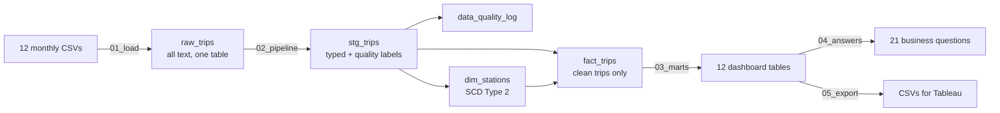

# Cyclistic Bike-Share: Turning Casual Riders into Members

**SQL (PostgreSQL) → Tableau** · a full data pipeline on 5.6 million real bike trips

Cyclistic is a bike-share company in Chicago (the Google Data Analytics capstone case study). The marketing director wants to turn **casual riders** (single rides or day passes) into **annual members**. This project answers the question a manager would actually ask:

> *Where, when and to whom should we market, how much money is it really worth, and how will we know the campaign worked?*

Most versions of this case study stop at "casual riders take longer rides on weekends". This one goes further:

- a **layered SQL pipeline** (raw → staging → station dimension → clean fact table → dashboard tables), with every removed row logged
- a **station history table (SCD Type 2)** so renamed or moved stations don't break trends
- an **honest revenue check**: some casual riders actually pay *more* than a membership costs, so converting them would lose money
- a **campaign measurement plan** (test zones vs. control zones, difference-in-differences) so the result can be proven, not just assumed
- **data quality checks** for impossible trip speeds, unusual days and broken records

---

## The data

| | |
|---|---|
| Source | [Divvy trip data](https://divvy-tripdata.s3.amazonaws.com/index.html), Motivate International Inc., under [this licence](https://divvybikes.com/data-license-agreement) |
| Period | April 2021 – March 2022 (12 monthly CSV files) |
| Size | ~5.6 million trips, 13 columns |
| One row = | one bike trip: start/end time, start/end station, coordinates, bike type, rider type (member or casual) |

The CSV files are not in this repo (they're too large). Download them from the link above.

**Important limit:** the data has no rider ID, so we can count *trips* but not *people*. Any "number of riders" figure is an estimate, and the SQL says so where it's used.

---

## How the pipeline works



| File | What it does |
|---|---|
| `sql/00_setup.sql` | Creates the `cyclistic` schema, the raw table, the assumptions table (prices, thresholds) and helper functions. **Wipes the schema**, so use it only on a fresh start. |
| `sql/00_setup_keep_raw.sql` | Same setup but keeps already-loaded data. Use this if `raw_trips` is already full. |
| `sql/01_load.sql` | Loads all 12 CSVs into **one** table, tagging each row with its file name |
| `sql/02_pipeline.sql` | Cleans and types the data, logs every removed row, builds the station history and the clean trip table |
| `sql/03_marts.sql` | Builds small summary tables, one set per dashboard, so Tableau stays fast |
| `sql/04_answers.sql` | The 21 business questions, each with the manager's question written above it |
| `sql/05_export_for_tableau.sql` | Saves the summary tables as CSVs (Tableau Public can't connect to a database) |
| `scripts/load_all.sh` | Loads every CSV in a folder, whatever the file names |

### Run it yourself

```bash
psql -d Portfolio_DB -f sql/00_setup.sql
cd path/to/divvy_csvs && psql -d Portfolio_DB -f path/to/sql/01_load.sql && cd -
psql -d Portfolio_DB -f sql/02_pipeline.sql      # a few minutes on 5.6M rows
psql -d Portfolio_DB -f sql/03_marts.sql
psql -d Portfolio_DB -f sql/04_answers.sql > results/answers_output.txt
mkdir -p tableau/data && cd tableau/data && psql -d Portfolio_DB -f ../../sql/05_export_for_tableau.sql
```

Tested on PostgreSQL 16 and 18. No extensions needed.

---

## The 21 business questions

Full wording and the reasoning behind each one: [`docs/business_questions.md`](docs/business_questions.md).

| # | Question | Dashboard |
|---|---|---|
| **A. Who and where** | | |
| 1 | Which stations have the most casual riders? | Where to target |
| 2 | Which casual riders already ride like members (weekday commuters)? | Where to target / Conversion |
| 3 | What routes do casual riders take most? | Where to target |
| 4 | Which stations are member strongholds, casual hotspots, or up for grabs? | Where to target |
| 5 | Which **areas** (not single stations) should we buy ads in? | Where to target |
| **B. When** | | |
| 6 | When should we launch the campaign? | Timing |
| 7 | What hours and days does each group ride? | How they differ |
| 8 | Is the casual share going up or down? | Overview |
| 9 | What casual demand should we expect next season, and how sure can we be? | Timing |
| **C. Money** | | |
| 10 | If we convert some casual riders, how much money is that? | Conversion |
| 11 | Would converting some riders actually *lose* us money? | Conversion |
| 12 | Casual riders take long rides. Is our pricing right? | How they differ |
| 13 | Is there demand for a weekend or summer membership? | Conversion |
| 14 | Who uses e-bikes, and should e-bike prices differ? | How they differ |
| **D. Proving it worked** | | |
| 15 | How will we know the campaign caused the change, not the weather? | Measurement |
| **E. Operations** | | |
| 16 | Which stations always run empty or overflow, and when? | Operations |
| 17 | Where do we need more docks next year? | Operations |
| **F. Data quality** | | |
| 18 | How many trips are broken, lost or bad data? | Data quality |
| 19 | Are there trips too fast to be physically possible? | Data quality |
| 20 | Which unusual days would distort our trends? | Data quality |
| 21 | How do we keep trends right when stations are renamed or moved? | Data quality |

---

## Design decisions

- **One raw table, all text.** Loading never fails on a bad value. Types are checked in the next step, where problems are labelled rather than lost.
- **Nothing is deleted silently.** Every bad row gets a reason (duplicate, under 1 minute, over 24 hours, negative time, impossible speed), and `data_quality_log` counts them per file. Trips with no end station are kept but flagged, because dockless e-bike trips are real trips.
- **Stations keep their history.** A rename, or a move of more than 150 m, creates a new version of the station with `valid_from` / `valid_to` dates. Each trip links to the version that was correct on the day, and trends roll up by the station's stable ID.
- **Every assumption sits in one table.** Prices and thresholds live in `cyclistic.assumptions`. Change a value, re-run, and every answer updates. **Prices are placeholders**: check them against [Divvy's pricing page](https://divvybikes.com/pricing) before quoting any dollar figure.
- **Honest about what one year can and can't show.** With 12 months of data, the year-on-year parts of Q8, Q9 and Q17 have nothing to compare against and come back empty. Loading a second year fills them in with no code changes.

---

## Results

Key findings and the output of all 21 questions: [`results/`](results/)

## Tableau dashboards

Link and dashboard plan: [`tableau/`](tableau/)

---

## Tools

PostgreSQL 18 · pgAdmin 4 · psql · Tableau Public · Git/GitHub

## Author

**Aditya Choudhary** · Data Analyst / BI Developer · [GitHub](https://github.com/Aditya-Choudhary-Dev)
